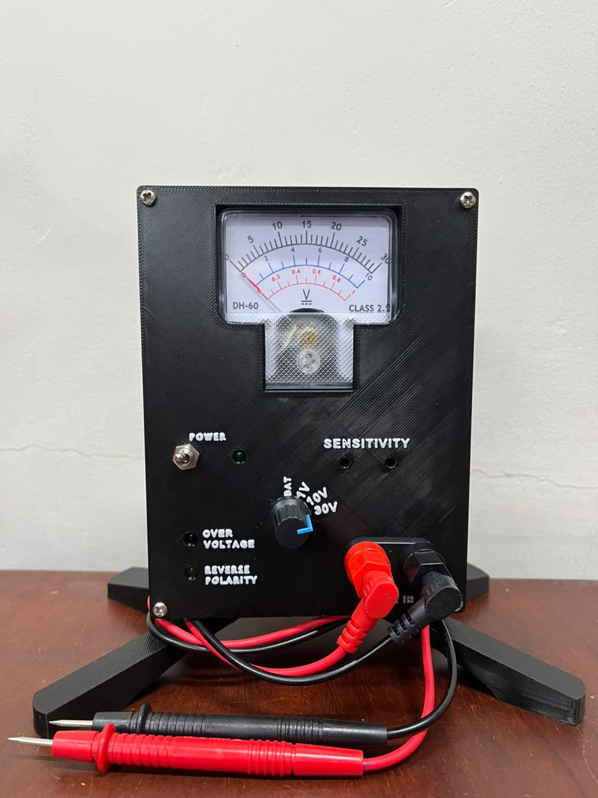
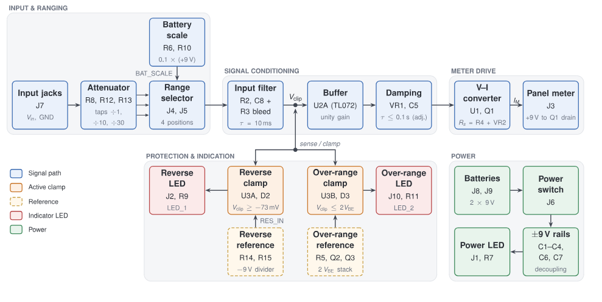

# Multi-Range Electronic Analog Voltmeter (CD-AVM30)

A battery-powered, multi-range electronic analog voltmeter measuring **0 to 30 V DC** across three selectable ranges (**1 V, 10 V, 30 V full scale**) plus a built-in battery check mode. Designed using strictly discrete semiconductors and standard op-amps (no voltage-reference or meter-driver ICs), simulated in **LTspice**, laid out on a 2-layer PCB in **Altium Designer** (0 DRC violations), and housed in a custom 3D-printed **SolidWorks** enclosure.

---

## Key Performance Specifications

| Parameter | Target Spec | Measured / Achieved |
| :--- | :--- | :--- |
| **Measurement Range** | 0 V – 30 V DC | 1 V, 10 V, 30 V FS + Battery Check |
| **Full-Scale Accuracy** | ±1.0% FS | **≤ 0.4% FS** across all ranges |
| **Input Resistance** | High impedance | **2.31 MΩ** (1 V), **2.99 MΩ** (10 V), **3.00 MΩ** (30 V) |
| **Over-Range Protection** | Active clamp + LED | Active clamp at **1.22 V** (LED triggers 116.5%–121.1% FS) |
| **Reverse-Polarity Protection** | Active clamp + LED | Active clamp at **-73 mV** (0 mA meter current) |
| **Needle Damping Control** | Adjustable response | **0–100 ms** adjustable RC time constant (`VR1`, `C5`) |
| **Power Supply** | Portable dual rail | **±9 V** (2 × 9 V PP3 batteries, DPDT switched) |
| **PCB** | Manufacturable 2-layer | 100 mm × 60 mm FR-4 (JLCPCB), **0 DRC violations** |

---

## System Architecture & Engineering Highlights

* **High-Impedance Single-String Attenuator:** A 3 MΩ divider (`2.7 MΩ / 200 kΩ / 100 kΩ`) scales all ranges to 0–1 V, achieving greater than 100× the input impedance of a passive 20 kΩ/V meter.
* **Discrete Active Protection Clamps:** Dual `TL072CP` op-amps with `1N4148` steering diodes clamp the internal node between `-73 mV` and `+1.22 V` (referenced by a diode-connected `2N3904` 2V_BE stack), protecting the moving-coil movement without specialized reference ICs.
* **Split-Stage Precision Signal Chain:** A `TL072CP` JFET unity-gain buffer (~65 pA bias current) prevents loading of the clamped node, while an `OP07CP` (60 μV typ. offset) driving a `2N7002` N-channel MOSFET forms a V-I converter (`Rs = 834.72 Ω`, calibrated via 25-turn `VR2`) with zero DC gate current loss, making deflection independent of meter coil resistance (`162 Ω`) and battery droop.
* **Hardware Error Compensation:** Bench characterization identified divider loading from the 10 MΩ bleed resistor (`R3`) on the 10 V and 30 V taps (-2.6% and -1.0%); a custom 3-arc scale face was generated for the DH60 meter to bring all ranges within 0.4% FS.

---

## PCB & Mechanical Implementation

* **PCB Layout (`hardware/altium/`):** 2-layer 1.6 mm FR-4 (100 × 60 mm), top and bottom stitched ground pours, 12 mil signal / 24 mil power traces, edge-mounted `KF301` screw terminals and `JST-XH` headers, mixed THT/0805 SMD assembly.
* **Enclosure (`mechanical/solidworks/`):** 108 × 60 × 143 mm PLA enclosure modeled in SolidWorks around the imported Altium STEP model for exact M3 stand-off and front-panel cutout alignment.

---

## Repository Contents

| Folder | Contents |
| :--- | :--- |
| [`hardware/altium/`](hardware/altium/) | Altium Designer project, schematic (`.SchDoc`), PCB layout (`.PcbDoc`), integrated library, and netlists |
| [`hardware/fabrication/`](hardware/fabrication/) | JLCPCB Gerbers (RS-274X), NC Drill files, LCSC BOM (`.csv`), Pick-and-Place, DRC report, and STEP model |
| [`simulation/ltspice/`](simulation/ltspice/) | LTspice DC sweep circuit (`.asc`), plot setup (`.plt`), and TI `TL072` macro-model |
| [`mechanical/solidworks/`](mechanical/solidworks/) | SolidWorks enclosure parts (`.SLDPRT`), full assembly (`.SLDASM`), and component STEP models |
| [`docs/`](docs/) | [Full Technical Report](docs/03_Circuit Dynamics_EN2091_Analog_Project.pdf.pdf), [CD-AVM30 Datasheet & User Manual](docs/CD-AVM30_Datasheet_UserManual.pdf), and Final Presentation |

---

## Team Credits

Developed by **Team Circuit Dynamics** for *EN2091 Laboratory Practice and Projects (Semester 3)*, Department of Electronic & Telecommunication Engineering, University of Moratuwa (Nov 2026).

| Member | Index No. | Contributions |
| :--- | :--- | :--- |
| Akash Jayasinghe (H. R. A. I. Jayasinghe) | 240275K | Schematic Design, PCB Design (Altium Designer), Soldering, Testing & Debugging |
| T. U. Dambarage | 240082P | Schematic Design, Enclosure Design (SolidWorks), Component Procurement, Testing & Debugging |
| S. N. Jayasooriya | 240284L | Schematic Design, PCB Design (Altium Designer), Documentation, Testing & Debugging |
| A. Y. D. Perera | 240495J | Schematic Design, Enclosure Design (SolidWorks), LTspice Simulation, Testing & Debugging |